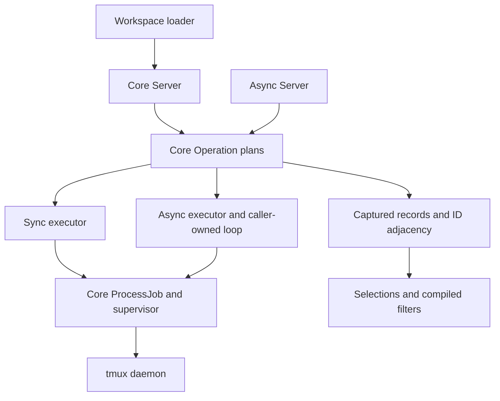

# ADR 0001: Explicit snapshots and optional execution adapters

## Status

Accepted implementation baseline, recorded 2026-11-08. This record documents
the existing architecture; it introduces no new execution mode or dependency.
The [source baseline](https://github.com/libtmux/libtmux-perl/tree/7ef1371b97fdaa48973f47fc7b0bc198ed4acc03)
allows readers to distinguish the recorded implementation from later changes.

## Context

Perl callers need to create and inspect tmux resources, filter an observed
graph, and load workspaces without adopting an object framework or an event
loop. Some callers also need concurrent operations and Future composition.
These uses share tmux targeting, decoding, identity, and failure semantics.

tmux exposes a graph. Its
[`winlink`](https://github.com/tmux/tmux/blob/3.8/tmux.h#L1510) associates a
session index with a
[`window`](https://github.com/tmux/tmux/blob/3.8/tmux.h#L1435), which owns
[`window_pane`](https://github.com/tmux/tmux/blob/3.8/tmux.h#L1304) records.
One physical window can have several links, including several indexes in one
session. Treating every listing row as a distinct physical window loses that
identity; treating all links as one row loses session context.

The companion [OCaml core's `Snapshot`](https://github.com/libtmux/libtmux-ocaml/blob/53a51bed2caa198be0fc3d81cb464e29d9f29403/lib/libtmux.mli#L381)
also separates captured graphs from
[`Command`](https://github.com/libtmux/libtmux-ocaml/blob/53a51bed2caa198be0fc3d81cb464e29d9f29403/lib/libtmux.mli#L861)
descriptions. Python's
[`QueryList`](https://github.com/tmux-python/libtmux/blob/v0.62.0/src/libtmux/_internal/query_list.py#L327)
provides a domain precedent for filtering and cardinality. These are behavioral
references. Perl's array semantics, reference counting, dependency policy, and
error conventions require their own contracts.

The [native operation inventory](../../behavior-inventory.json) and
[Python behavior dispositions](../../python-behavior-inventory.json) map
upstream behavior to Perl signatures, native adaptations, and explicit
exclusions. They define the operation scope alongside this record.

## Decision

### Keep three independently installable distributions

| Distribution | Owns | Runtime requirements |
| --- | --- | --- |
| `LibTmux` | Server operations, command plans, process ownership, framing, catalog, snapshots, selections, filters, errors. | Perl standard library and the qualified Linux ABI. |
| `LibTmux-Async` | Future-returning facade, bounded submission, event-loop integration, asynchronous shutdown observers. | Versioned core, Future 0.54, IO::Async 0.805. |
| `LibTmux-Workspace` | Versioned JSON configuration, planning, loader CLI, and orchestration through public core APIs. | Versioned core and Perl standard library. |

Each distribution owns its MakeMaker declaration, dependency phases, README,
license, and module version. Shared author tools stay at the repository root.
Core and workspace do not load the optional async dependencies. Workspace
does not implement tmux protocol or reach into a core's private store.

Use ordinary packages with positional signatures and stable Perl 5.44
features. The [Perl 5.44 release documentation](https://github.com/Perl/perl5/blob/v5.44.0/pod/perldelta.pod)
is the language baseline. Experimental class syntax, named signature
parameters, `any`/`all` keywords, and `finally`/`defer` are outside this baseline.
Consumers need no Moo, Moose, Object::Pad, or custom predicate superclass.

The diagram shows dependency and data flow. Constructing a plan or traversing
captured data does not dispatch a command. The
[`Operation`](../../../packages/core/lib/LibTmux/Operation.pm) and
[`ProcessJob`](../../../packages/core/lib/LibTmux/ProcessJob.pm) seams keep
preparation, parsing, and lifecycle rules shared between executors.

### Make acquisition and mutation explicit

[`Server->new`](../../../packages/core/lib/LibTmux/Server.pm) validates and
copies connection settings without starting tmux. A caller chooses a socket
name or path, executable, environment, deadline, and output bound. Explicit
operations acquire or mutate resources. Captured field and relationship
accessors perform no I/O, and a new snapshot leaves earlier captures intact.

IDs remain strings scoped by server and observed daemon generation. A pane
handle does not become a pane on a restarted server merely because its `%` ID
is reused. Mutations validate captured targets and require explicit link
context for session-relative window operations. A generation probe and a
later command are separate observations; they do not eliminate every race.

The OCaml core exposes the comparable separation through
[`Source`](https://github.com/libtmux/libtmux-ocaml/blob/53a51bed2caa198be0fc3d81cb464e29d9f29403/lib/libtmux.mli#L92)
and typed `Command` descriptions. Perl uses schema validation and typed
exceptions where OCaml uses types and result values. One port's successful
checks do not establish another port's compatibility.

### Own bounded subprocesses without borrowing application signals

The synchronous executor uses literal argument vectors, separate byte
streams, monotonic deadlines, bounded retained output, and a private
supervisor. The supervisor owns the submitted process group, drains both
output pipes, handles cancellation, and reaps owned descendants. It does not
replace the application's signal handlers. `SIGCHLD=IGNORE` is unsupported
because reliable child status is then unavailable; competing all-child
reapers are also outside the ownership contract.

The Linux adapter uses
[`PR_SET_CHILD_SUBREAPER`](https://github.com/torvalds/linux/blob/v6.18/include/uapi/linux/prctl.h#L158).
The implemented syscall boundary is Linux x86_64 LP64, including WSL; another
ABI is refused before dispatch. A standard-library runtime dependency policy
does not make this implementation portable to every Perl platform. The cost
of owning this adapter is maintaining its signal, pipe, and reaping tests.

[`Transport`](../../../packages/core/lib/LibTmux/Transport.pm) returns a
`CommandResult` for an ordinary process exit, including nonzero status.
Spawn, timeout, cancellation, output-limit, and supervision failures are typed
errors. Server operations translate unsuccessful tmux commands into typed
domain errors while retaining the cause and dispatch information. Failure
does not mean an empty selection, and cancellation after submission does not
mean the command never ran.

Argument-vector safety and tmux syntax are separate concerns. tmux's
[`cmd_new_session_exec`](https://github.com/tmux/tmux/blob/3.8/cmd-new-session.c#L68)
accepts commands whose execution rules include shell behavior. The core
preserves literal argument boundaries; a single-item command array uses a
fixed exec-ARGV shim to avoid tmux's single-command shell interpretation.
Explicit shell commands remain a separate caller choice. Command acceptance
does not prove application readiness or detached-client exit.

Closing an executor owns only its jobs and pipes. Snapshot handles own no live
transport, and destruction never kills a borrowed tmux server.

### Frame bytes before decoding fields

[`Codec`](../../../packages/core/lib/LibTmux/Codec.pm) uses tmux format
substitution to escape backslash, tab, and newline before delimiting records.
It evaluates each requested value once. A length prefix computed through a
second lookup could disagree with a dynamic value; a raw fixed delimiter could
occur in caller-controlled text.

The upstream implementation of substitution is
[`format_sub`](https://github.com/tmux/tmux/blob/3.8/format.c#L5127); format
expansion passes through
[`format_replace`](https://github.com/tmux/tmux/blob/3.8/format.c#L6019).
Supported tmux versions need their own codec checks even when a newer source
link illustrates the mechanism.

Keep process output as octets through framing. Decode text fields as strict
UTF-8 and preserve path fields as bytes. Reject malformed escapes, record
boundaries, or field counts. Do not replace invalid bytes before comparison.
Local opaque paths remain usable; the initial JSON representation refuses
paths it cannot represent as valid Unicode text.

### Retain captured graphs without reference cycles

The store owns copied scalar records, order, completeness metadata, and
adjacency IDs. Entity handles retain that store strongly; the store does not
retain entity handles. Relationships resolve through IDs and return local
handles or fresh selections. This preserves a retained pane's captured window
after the acquiring variable leaves scope without a parent/child reference
cycle. Retaining one pane can retain the whole captured graph; `to_record`
and `to_records` provide detached scalar exports.

[`Snapshot`](../../../packages/core/lib/LibTmux/Snapshot.pm) enumerates physical
windows and panes once. `window_links` retains each association; raw listing
rows retain their context and multiplicity. `WindowLink` owns session-relative
index and active state. `Pane->window` always returns a physical window.
Pane activity is a different field from a session's current window link.

Capture start/end describe an observation interval. Strict live acquisition
rejects incomplete required topology. A known null, an unloaded field, and a
loaded empty relation remain different states. Public accessors expose
read-only captured values and membership copies. As with other Perl objects,
direct edits to private hash storage are outside that public contract.

The OCaml `Snapshot.create` contract similarly retains distinct links and
rejects conflicting topology, but its immutable `Iarray` collections do not
transfer to Perl. Perl's public selection remains a real mutable array
reference. See [graph identity](../../graph.md) for cross-capture membership:
selections may combine handles from the same server generation, with each
handle still observing its own captured graph.

### Preserve native arrays and fixed selection returns

Concrete selection classes are blessed array references whose class supplies
the entity schema even when empty. Indexing, postfix dereferencing, ordinary
`grep`, `map`, and `sort` remain available. The precedent is
[`Mojo::Collection->new`](https://github.com/mojolicious/mojo/blob/v9.43/lib/Mojo/Collection.pm#L63),
not a mandatory collection framework dependency.

`where` and method `grep` eagerly return a new selection of the same concrete
class in scalar, list, and void context. They preserve order and duplicate
occurrences. `to_array` returns an unblessed membership copy. There is no
count-based Boolean overload; callers use `exists` or `count`.

[`Selection::grep`](../../../packages/core/lib/LibTmux/Selection.pm) invokes
the callback in scalar context with one entity argument and localized `$_`.
Both receive copies of the entity reference, so assigning to either does not
replace a source slot. Exceptions propagate unchanged and the caller's `$_`
is restored. Predicates must not mutate the sequence being traversed.

Every library operation validates all membership before callback or
cardinality short-circuiting. Wrong-kind objects, holes, mixed server scopes,
and mixed generations are errors. An iterator freezes membership at creation.
`first` returns an entity or `undef`; `one` requires exactly one occurrence;
`one_or_undef` permits absence but rejects ambiguity. Two occurrences of one
physical identity remain two occurrences, and ambiguity diagnostics do not
invent a total after stopping at the second match.

### Validate a small criteria language against one catalog

[`schema.json`](../../../packages/core/lib/LibTmux/schema.json) owns field
names, wire names, types, nullability, operators, relation cardinality, source
scope, and version capabilities. Generated readers and field documentation
derive from it. Input keys do not become arbitrary method calls. Registered
record/object adapters define readers explicitly without requiring model
inheritance.

`where` accepts one criteria hash or a compiled `LibTmux::Filter`. The
dash-prefixed vocabulary borrows from SQL::Abstract without claiming its
grammar. Bare equality, explicit membership, ordered numeric comparisons,
literal text operations, Boolean nodes, and relation quantifiers have the
documented [filtering semantics](../../filtering.md). Native Perl regexes and
application behavior belong in callbacks.

Compilation validates the whole tree before reading members, including empty
inputs and branches later skipped. Hash keys and field operators traverse in
lexical order; logical arrays retain their order. Deterministic
short-circuiting may avoid unavailable reads. Compilation rejects cycles and
bounds nesting to 64 levels and traversal to 10,000 nodes. The schema selects text,
Boolean, or integer comparison, independently of a Perl scalar's history.
Integers use the cross-language safe range, plus or minus 9007199254740991.
False, zero, `"0"`, empty text, explicit `undef`, and omitted keys stay distinct.

Known-null ordering and substring comparisons are false; equality can test
nullable absence, and `-ne` is its complement. Unloaded data throws when read.
For a loaded empty to-many relation, `-some` is false and `-every`/`-none` are
true. One existential subtree describes one child; two existential subtrees
may match different children. Relation evaluation never acquires more data.

[`Filter`](../../../packages/core/lib/LibTmux/Filter.pm) copies normalized
input and exports the proposed `libtmux.where/v1` JSON envelope through
JSON::PP. Wire fields use canonical catalog names and operators omit the
leading dash. Reject executable or arbitrary blessed values, cycles, unknown
versions, and unsupported operators. The wire format does not imply that
other ports accept it. The
[independent evaluator pin](../../../scripts/conformance-reference.json)
and [conformance fixtures](../../../conformance/where-v1.json) declare the
tested common subset and the known null-equality disagreement; a JSON round
trip alone is insufficient cross-port evidence.

### Verify scalar native candidates against captured local semantics

`explain_panes` constructs a local plan using the support-floor capabilities;
execution binds it to the connected daemon. `query_panes` explicitly acquires
data. Plans expose required fields, relations, commands, lowered predicates,
residual predicates, and reasons exact lowering is unavailable.

The implementation captures and locally evaluates the complete graph before
verifying native candidates. This preserves availability errors and complete
relation domains. It currently makes no I/O-saving claim. `never` uses local
evaluation, `auto` falls back to the captured local result on candidate
disagreement, and `require` rejects incomplete lowering or disagreement.

An exact conjunct can prune candidates under AND. An OR branch alone cannot;
negation needs an equivalent complete subtree. Numeric comparisons use tmux
numeric expressions, and literals need tmux-format escaping independently of
process argument safety. Relations, null, bytes, and unsupported operators
stay local. Native filtering never shrinks the child domain for `every` or
`none`. See [query planning](../../query-planning.md) and
[`QueryPlan`](../../../packages/core/lib/LibTmux/QueryPlan.pm).

`native_filter` is an explicit, exclusive escape hatch with tmux semantics.
It does not become portable criteria. Multiple subprocess calls still observe
an interval; candidate verification is not a transaction.

### Make async cancellation and cleanup separate observations

The optional facade returns standard Future objects and borrows an explicit
caller-owned IO::Async loop. It does not create, run, or stop that loop.
[`Loop::fork`](https://metacpan.org/release/PEVANS/IO-Async-0.805/view/lib/IO/Async/Loop.pm#fork)
owns supervisor exit observation, and an IO::Async stream reads the shared
ProcessJob result protocol. The async adapter waits for both result EOF and
supervisor exit before finalizing a job.

Submission defaults to four active jobs and 64 queued requests. Queue overflow
fails before dispatch. Ordered batches contain independent requests with
individual result/error attribution, rather than a tmux command list with
invented per-command completion.

[`Future::cancel`](https://metacpan.org/release/PEVANS/Future-0.54/view/lib/Future.pm#cancel)
can make a Future ready before cleanup finishes. Cancellation requests owned
job cleanup and suppresses later continuations; it cannot undo tmux effects.
[`Async::Transport::close`](../../../packages/async/lib/LibTmux/Async/Transport.pm)
rejects new work, cancels queued/running requests, and returns a fresh observer
of private cleanup. Cancelling that observer cannot cancel cleanup. Only
successful `is_done` completion proves shutdown; the caller must keep driving
the borrowed loop. Future::AsyncAwait remains optional caller syntax.

### Give workspace loading an honest partial-effect contract

The [workspace loader](../../workspace.md) accepts the versioned
`libtmux.workspace/v1` JSON format. Validation and `plan` do not contact tmux.
`load` uses installed public core APIs to create sessions, windows, panes,
layouts, working directories, environment, and explicitly chosen commands.
Command arrays and `shell_command` have different meanings.

Existing targets use explicit `error` or `skip` behavior. `skip` preserves an
existing session as a whole; it is not a reconciliation engine. On failure,
rollback targets only sessions whose successful creation returned ownership
evidence. The typed load error preserves the original cause, partial effects,
and cleanup failures. Pre-existing resources are never rollback targets.
Command acceptance and captured handles do not certify application readiness.

### Keep documentation and qualification tied to their inputs

Installed API documentation uses POD `L<>` links to real packages, methods,
and sections. Author-only PPI extraction preserves declared positional
signatures and their source spans; Pod::Simple parses authored POD. Package
namespaces and inheritance are separate: `LibTmux::Async::Server` is not
automatically a declaration nested inside `LibTmux::Async`.

The native export records library and exporter identities separately. Shared
site builds and publication use the same pinned renderer revision and an
exact artifact descriptor. Unpublished distributions are labelled as source
previews; their real overview pages remain useful destinations. Perl MCP is
excluded and has no package or product destination. Package publication and
shared-site deployment require separate authority.

[Compatibility](../../compatibility.md) defines the Linux/Perl/tmux cells;
the [source lock](../../../scripts/tmux-lock.json) pins builds. Validation
includes Test2::V1 units, isolated real-tmux fixtures, POD, runnable examples,
native archives, and installed consumers outside the checkout. Fixtures own
their sockets and prove process exit. The [contributor guide](../../../.github/CONTRIBUTING.md)
owns exact commands and loop budgets. An ADR or a source-level check does not
substitute for a current runtime or publication gate.

## Alternatives considered

| Alternative | Decision and cost |
| --- | --- |
| Moo/Moose or experimental core classes | Ordinary packages meet the implemented public needs without a consumer framework or experimental language contract. Constructor and reader validation remain explicit library work. |
| Live relationship properties and lazy query execution | Captured local access makes I/O visible and retained observations predictable. Callers must request a new capture when freshness matters. |
| Immutable collection wrappers | Real blessed arrays preserve Perl interoperability. Native mutation requires membership validation and a clear nonmutating-method promise. |
| One process implementation per facade, or mandatory IPC::Run | Shared ProcessJob supervision preserves one ownership protocol and a standard-library core. It also creates a Linux adapter and maintenance burden that must be justified by its lifecycle evidence. |
| Persistent control as the default | tmux's [control protocol](https://github.com/tmux/tmux/blob/3.8/tmux.1#L9068) includes unsolicited notifications and client lifetime. It remains deferred until framing, loss recovery, and equivalence are independently qualified. |
| Streaming subscriptions or tmux command chaining | Completed bounded results and ordered independent requests cover the selected scope. Streaming backpressure and group-versus-command attribution need distinct contracts and gates. |
| Raw delimiters or two-lookup length prefixes | Reversible substitution avoids user-text delimiter collisions and dynamic-value disagreement. Codec correctness must be checked on each supported tmux release. |
| General ORM grammar, serializable Perl regex, or relation pushdown | A smaller validated grammar has testable null, availability, and quantifier semantics. Richer backends remain deferred; callbacks retain Perl's native expressiveness. |
| YAML as the required workspace format | Core JSON::PP supports the selected configuration contract. Another format needs a justified public adapter. |

## Consequences

The public API keeps process execution, captured values, query data, and
workspace orchestration distinct. Async adds scheduling without a second tmux
model. Callers can use ordinary arrays, accessors, hashrefs, and callbacks.

The costs are concrete: retained handles can retain a whole graph, snapshots
can become stale, safe native querying currently does extra acquisition,
native array mutation needs validation, and the private Linux supervisor is
code this project must maintain. Runtime schemas provide diagnostics, not
compile-time checking of arbitrary Perl hashrefs. The selected Linux ABI and
current execution modes bound support.

## Verification and reconsideration

The critical contracts map to existing checks:

| Contract | Evidence entry points |
| --- | --- |
| Stable returns, callback isolation, graph retention, criteria and wire data | [selection units](../../../packages/core/t/unit/selection.t), [availability units](../../../packages/core/t/unit/availability.t), [conformance runner](../../../scripts/conformance.py). |
| Literal I/O, framing, signal ownership, timeout and cleanup | [transport units](../../../packages/core/t/unit/transport.t), [codec units](../../../packages/core/t/unit/codec.t), [lifecycle integration](../../../packages/core/t/integration/lifecycle.t). |
| Linked graph identity and native/local equivalence | [tmux integration](../../../packages/core/t/integration/tmux.t), [query integration](../../../packages/core/t/integration/query-planning.t). |
| Async admission, borrowed-loop lifetime and cancellation versus close | [async transport units](../../../packages/async/t/unit/transport.t), [async live integration](../../../packages/async/t/integration/tmux.t), [parent-loss integration](../../../packages/async/t/integration/parent-loss.t). |
| Workspace dry-run, repeat behavior and owned rollback | [configuration units](../../../packages/workspace/t/unit/config.t), [load integration](../../../packages/workspace/t/integration/load.t), [creation-failure integration](../../../packages/workspace/t/integration/creation-failure.t). |
| Installed distributions and executed caller examples | [artifact checks](../../../scripts/check-artifacts.pl), [installed consumer](../../../scripts/installed-consumer.pl), [complete examples](../../../examples). |

Reopen a decision when a caller needs a currently deferred capability, another
ABI can satisfy the same ownership checks, a dependency demonstrably removes
more lifecycle risk than it adds, or a counterexample contradicts a public
contract. Record the counterexample and affected callers before changing the
implementation; qualify changed behavior and update the owning guide.

## Source pin policy

Upstream Git links use release tags and point to the named symbol or section.
tmux 3.8 illustrates upstream structures; it does not raise the 3.3a support
floor. The Mojo and Python tags document precedents, not required runtime
versions or full behavioral equivalence. The conformance runner retains its
own exact independent-evaluator revision.

Perl and OCaml had no repository tags when this record was written, so their
recorded source links use full commits. Future and IO::Async links use exact
CPAN releases and POD symbol anchors. No tag or dependency was invented to
make a source link. Relative implementation links follow the checked-out
revision; the recorded source baseline remains available for historical review.
